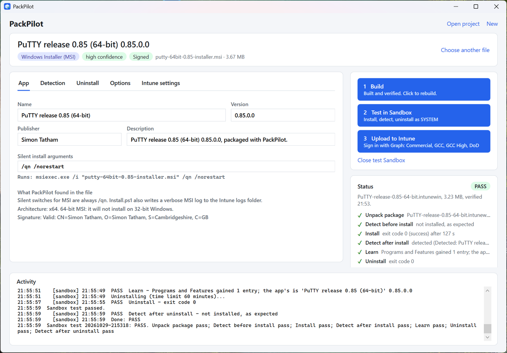
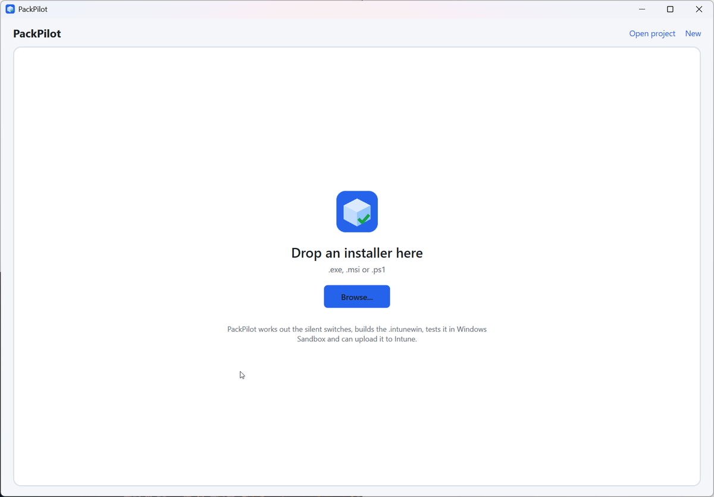
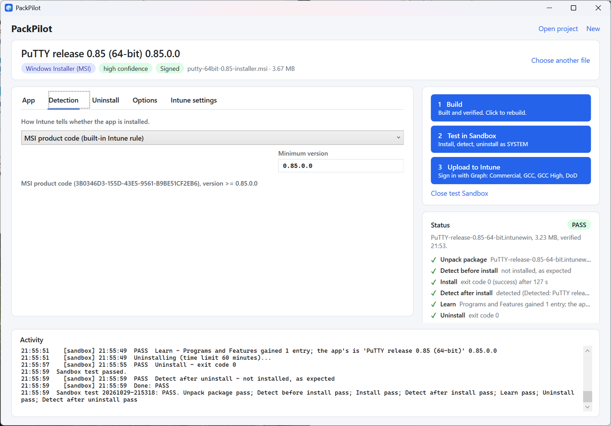
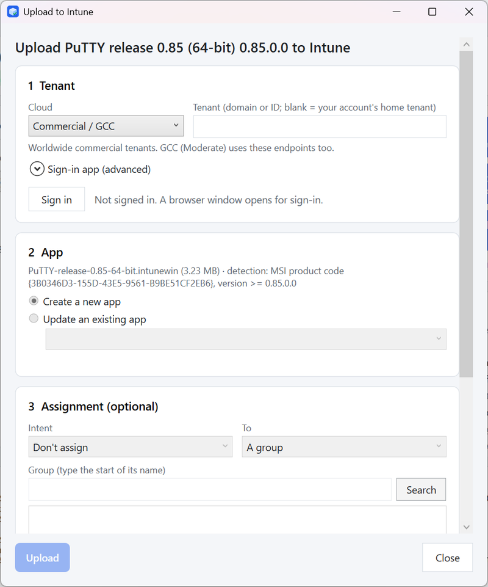
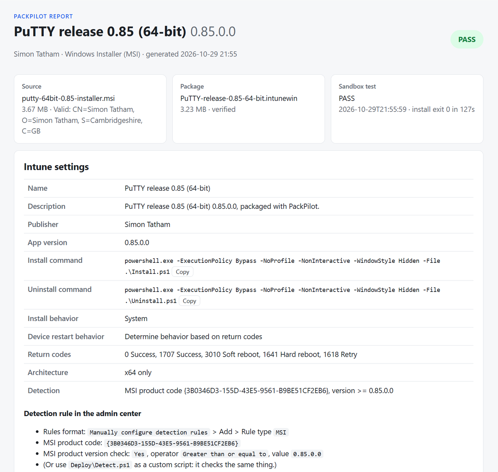

# PackPilot

A Windows desktop app for Intune Win32 apps. Drop in an `.exe`, `.msi` or `.ps1` and it:

1. **Reads the installer**: works out the engine (MSI, Inno Setup, NSIS, WiX Burn, InstallShield, Advanced Installer, and more), the silent switches, name, version, publisher, MSI product code, architecture and signature.
2. **Builds the `.intunewin`**: no IntuneWinAppUtil.exe needed. It wraps the installer in `Install.ps1` / `Uninstall.ps1` (silent run, 64-bit relaunch, logging, exit code passthrough), encrypts it, then re-opens and verifies the package the way Intune does.
3. **Tests it in Windows Sandbox**: unpacks the real `.intunewin` inside a clean Sandbox, then runs detect → install → detect → uninstall → detect, all as SYSTEM, like the Intune agent. It also records what the install added to Programs and Features, and can use that for detection and uninstall.
4. **Uploads it to Intune** (optional, in testing): signs in with Microsoft Graph in the cloud you pick (Commercial/GCC, GCC High, DoD, China), creates or updates the Win32 app with the tested settings, uploads the package, and can assign it.
5. **Gives you the deployment kit**: the exact Intune portal values, a detection script, a ready-to-run upload script (`Deploy-ToIntune.ps1`), and `Report.html` with what was done and the test results.

> **Status:** building, Sandbox testing and the deployment kit are ready to use. **Upload to Intune is still in testing** against real tenants. Try it in a test tenant or with a pilot group first, and [open an issue](https://github.com/PresWiFi/PackPilot/issues) if anything goes wrong.



## Download

Get `PackPilot.exe` from the [latest release](https://github.com/PresWiFi/PackPilot/releases/latest) and double-click it. No install, and no admin rights needed. It's a single self-contained file (Windows 10/11 x64), so you don't need .NET installed either.

Code signing is being set up through SignPath (see [Code signing policy](#code-signing-policy)). Until a release says it's signed, Windows SmartScreen may say "Windows protected your PC": click **More info** > **Run anyway**. Each release lists the file's SHA-256 so you can check it first.

Testing needs **Windows Sandbox** (Windows 10/11 Pro, Enterprise or Education, with virtualization on). To turn it on, run this in an admin PowerShell, then restart:

```powershell
Enable-WindowsOptionalFeature -Online -FeatureName Containers-DisposableClientVM -All
```

## Screenshots

| Start | Detection |
|---|---|
|  |  |
| **Upload to Intune** | **Report** |
|  |  |

## How to use it

1. Drop an installer on the window (or click **Browse**). Check the fields it filled in.
2. Click **1 Build**.
3. Click **2 Test in Sandbox**. A Sandbox window opens and the test runs by itself; the results appear in PackPilot when it's done. Leave the Sandbox open until then.
4. For EXE and script installers, PackPilot asks to **use what the test learned** (the exact Programs and Features name, version, product code). Say yes, then run the test again to confirm.
5. Click **3 Upload to Intune**, or open the **Deployment guide** and follow Option A (admin center) or Option B (PowerShell upload).

## Upload to Intune (in testing)

This works against a simulated Microsoft Graph service in the self-checks, and is now being tested against real tenants. Until that's done, upload to a test tenant or assign to a pilot group, and check the app in the Intune admin center afterwards.

Click **Upload to Intune** after building (and ideally testing):

1. Pick the **cloud**: Commercial / GCC, GCC High, DoD, or China (21Vianet). This sets the sign-in and Graph endpoints (`login.microsoftonline.us` + `graph.microsoft.us` for GCC High, `dod-graph.microsoft.us` for DoD).
2. Optionally enter the **tenant** (`contoso.onmicrosoft.com` or its ID), then **Sign in**. A browser window opens.
3. If a Win32 app with the same name exists, PackPilot offers to **update** it (new package, same assignments) instead of creating a duplicate.
4. Optionally **assign** it: Required, Available or Uninstall, to a group (search by name), all devices or all users.

Permissions: delegated `DeviceManagementApps.ReadWrite.All` and `Group.Read.All`, plus an Intune role that can manage apps. By default PackPilot signs in through **Microsoft Graph Command Line Tools** (the same public app `Connect-MgGraph` uses), so there's nothing to register. An admin consents once. To use your own app registration instead, open **Sign-in app (advanced)** and enter its client ID. The registration needs those delegated permissions, "Allow public client flows" turned on, and the redirect URI `http://localhost`.

Tokens stay in memory and are gone when PackPilot closes. Each upload is recorded in `project.json` and the report.

## What it writes

Each app gets its own folder (default `Documents\PackPilot\<App>_<Version>`):

| Path | What it is |
|---|---|
| `Package\<App>.intunewin` | Upload this to Intune |
| `Source\` | What's inside the package: the installer, `Install.ps1`, `Uninstall.ps1` |
| `Deploy\DEPLOYMENT.md` | Step-by-step Intune settings, pilot checks, log locations |
| `Deploy\Deploy-ToIntune.ps1` | Uploads (and optionally assigns) the app with the IntuneWin32App module |
| `Deploy\Detect.ps1` | Detection script (for script detection, or to check a device by hand) |
| `Deploy\intune-app.json` | All settings, machine-readable |
| `SandboxTest\` | The Sandbox test kit; `Results\<run>\` has `result.json`, `progress.log` and every log |
| `Report.html` | What was done, verification, test results, deploy settings |
| `project.json` | Reopen the project later with **Open project...** |

## Intune settings it uses

- Install: `powershell.exe -ExecutionPolicy Bypass -NoProfile -NonInteractive -WindowStyle Hidden -File .\Install.ps1`
- Uninstall: the same with `.\Uninstall.ps1`
- Install behavior: System. Restart: based on return codes. Return codes: Intune defaults.
- Logs on the device: `C:\ProgramData\Microsoft\IntuneManagementExtension\Logs\PackPilot-<App>-Install.log` (and `-Uninstall.log`, `-MSI-Install.log`). That folder is what **Collect diagnostics** uploads.

Detection, by installer type:

| Type | Default detection | Uninstall |
|---|---|---|
| MSI | MSI product code (built-in rule) | `msiexec /x {ProductCode}` |
| EXE | Programs and Features name (detection script); refine with the Sandbox test | Looked up at uninstall time from Programs and Features (QuietUninstallString, or UninstallString plus the engine's silent flag) |
| PS1 | Registry marker that `Install.ps1` writes after the script exits 0 | Your uninstall script if you pick one (an `Uninstall*.ps1` next to it is picked up automatically) |

## What PackPilot changes on your PC

- It writes only where you'd expect: the output folder you choose (default `Documents\PackPilot`), settings in `%LOCALAPPDATA%\PackPilot\settings.json`, and Sandbox staging folders in `%LOCALAPPDATA%\PackPilot\SandboxRuns` and `Session` (cleaned up automatically).
- It installs nothing and changes no system settings. Installers you test only ever run inside Windows Sandbox, which is thrown away when it closes.
- **To remove it:** delete `PackPilot.exe` and the `%LOCALAPPDATA%\PackPilot` folder. Your packages stay in the output folder until you delete them.

## Build from source

Needs the .NET 8 SDK (`winget install Microsoft.DotNet.SDK.8`).

```powershell
.\build.ps1 -Test                # self-checks, then dist\PackPilot.exe (self-contained, ~70 MB)
.\build.ps1 -FrameworkDependent  # small exe; needs the .NET 8 Desktop Runtime
```

From Linux or WSL: `./build.sh` (WPF cross-builds with `EnableWindowsTargeting`).

Releases are built by GitHub Actions on Windows (`.github/workflows/release.yml`): push a tag like `v0.2.0` and it runs the self-checks, builds the exe, sends it to SignPath for signing once that's configured, and publishes the release. Release notes come from `docs/release-notes/<tag>.md`.

The self-checks (`dotnet run --project tests\PackPilot.Tests`) build a real package, decrypt it, compare the bytes, check a tampered package is rejected, and exercise the project, Sandbox kit and "learned values" logic. They run on any OS.

## Project layout

- `src/PackPilot.Core/Intune`: clouds, sign-in (MSAL), Graph upload (`IntuneUploader`)
- `src/PackPilot.Core`: analysis (`InstallerAnalyzer`), `.intunewin` build and verify (`IntuneWin`), PowerShell templates (`Scripts`), build pipeline (`PackageBuilder`), Sandbox (`Sandbox`), deployment kit, report
- `src/PackPilot`: the WPF window
- `tests/PackPilot.Tests`: self-checks

## Limits

- A Sandbox pass is strong evidence, not a guarantee. Pilot on a small group first.
- The Sandbox can't reboot mid-test (3010/1641 are reported, not acted on), and apps that need virtualization themselves (Hyper-V, WSL, Docker Desktop) won't run in it.
- Per-user installers (Squirrel and the like) land in the SYSTEM profile when installed as SYSTEM. The test flags this.
- Engine detection is static. For "Unknown EXE" the `/S` default is a guess: check the vendor's docs, then let the Sandbox test confirm it.

## Code signing policy

Free code signing provided by [SignPath.io](https://about.signpath.io), certificate by [SignPath Foundation](https://signpath.org).

- Committers and reviewers: [PresWiFi](https://github.com/PresWiFi)
- Approvers: [PresWiFi](https://github.com/PresWiFi)

Every release is built from this repository's source by GitHub Actions, and each signing request is approved by hand.

**Privacy:** this program will not transfer any information to other networked systems unless specifically requested by the user or the person installing or operating it. The only network connections it makes are the ones you start:
- **Upload to Intune** signs in with Microsoft and talks to Microsoft Graph in the cloud you choose ([Microsoft Privacy Statement](https://privacy.microsoft.com/privacystatement)).
- **Windows Sandbox tests** run installers in a disposable VM that has network access unless you turn it off in Options.
- **`test-installers\Get-TestInstallers.ps1`** downloads the sample installers from their vendors' sites when you run it.

## License

MIT, see [LICENSE](LICENSE). PackPilot builds on SwitchHunt and credits other open-source work in [THIRD-PARTY-NOTICES.md](THIRD-PARTY-NOTICES.md).
