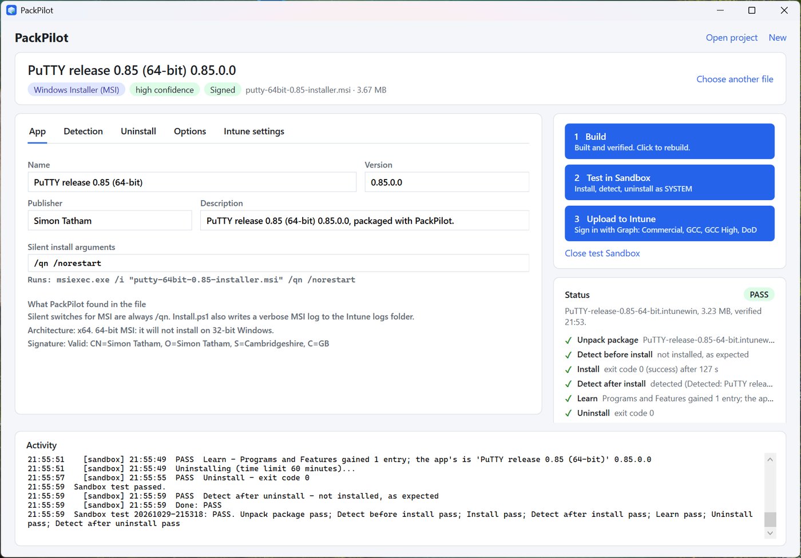
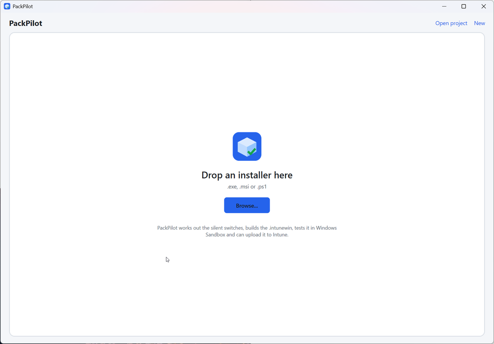
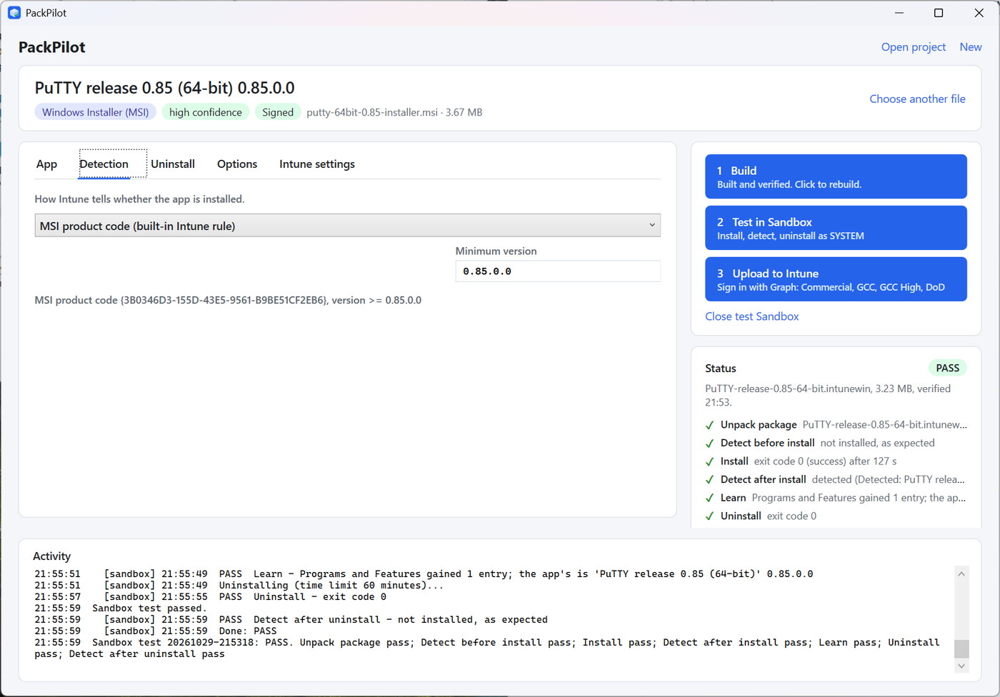
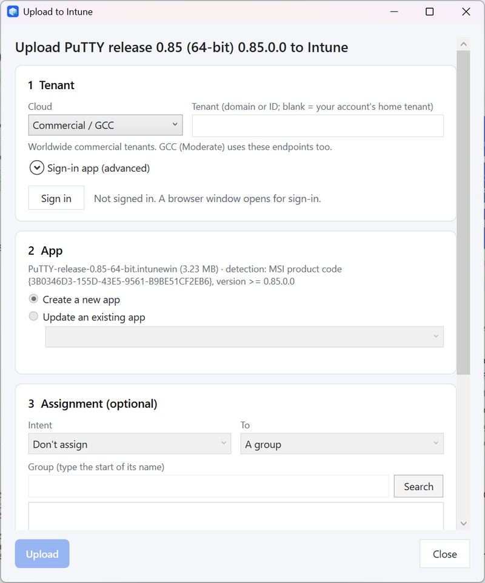
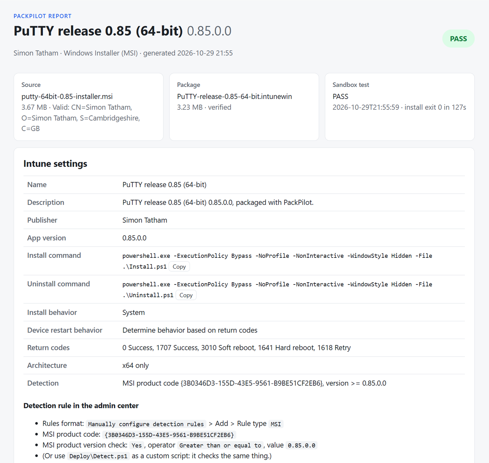

# PackPilot

Turn an `.exe`, `.msi` or `.ps1` into a tested Intune Win32 app.

> **Status:** Intune upload is in testing; use a test tenant or pilot group. Build and Sandbox testing are stable.



## What it does

- **Reads the installer:** engine (MSI, Inno Setup, NSIS, WiX Burn, InstallShield and more), silent switches, version, product code, signature.
- **Builds the `.intunewin`** without IntuneWinAppUtil, and verifies it the way Intune does.
- **Tests it in Windows Sandbox** as SYSTEM: detect, install, detect, uninstall, detect.
- **Uploads it to Intune** through Microsoft Graph: Commercial/GCC, GCC High, DoD or China. *(In testing.)*
- **Writes a deployment kit:** portal settings, detection script, upload script and an HTML report.

## Download

`PackPilot.exe` from the [latest release](https://github.com/PresWiFi/PackPilot/releases/latest). Single file, no install, admin or .NET (Windows 10/11 x64). Unsigned: SmartScreen → **More info** > **Run anyway**. SHA-256 is listed on each release.

Testing needs **Windows Sandbox** (Pro/Enterprise/Education). Enable from admin PowerShell and restart:

```powershell
Enable-WindowsOptionalFeature -Online -FeatureName Containers-DisposableClientVM -All
```

## How to use it

1. Drop an installer on the window and check the fields.
2. **Build.**
3. **Test in Sandbox.** Leave the Sandbox window open until the result shows.
4. If the red rebuild button appears, click it (the test found better detection values).
5. **Upload to Intune**, or add it manually with the deployment guide.

| | |
|---|---|
|  |  |
|  |  |

Permissions, outputs, Intune settings, limits and building: **[guide](docs/GUIDE.md)**.

## System and privacy

Installs nothing and changes no settings. Test installers run only in Windows Sandbox. To remove, delete `PackPilot.exe` and `%LOCALAPPDATA%\PackPilot`.

This program will not transfer any information to other networked systems unless specifically requested by the user or the person installing or operating it. Connections it makes: **Upload to Intune** (Microsoft sign-in and Graph, [privacy statement](https://privacy.microsoft.com/privacystatement)) and Sandbox network access (can be turned off).

## License

MIT. Builds on [SwitchHunt](https://github.com/deadarcher/SwitchHunt) ([notices](THIRD-PARTY-NOTICES.md)).
